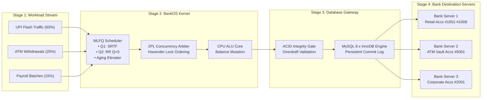

# BankOS: Banking Transaction Operating System & Relational DBMS Simulator
## Comprehensive Engineering & Academic Project Report

---

**Author / Candidate:** Mohan Kumar  
**Project Title:** BankOS: A Hybrid Operating System & Relational Database Simulator for High-Velocity Financial Transaction Arbitration  
**Technology Stack:** Modern C++ (C++20), Oracle MySQL 8.x (InnoDB Engine, X DevAPI), Multi-Level Feedback Queue (MLFQ) Scheduling, Strict Two-Phase Locking (2PL), Havender Monotonic Deadlock Denial, Measurement-Driven Adaptive Concurrency Control (MD-ACC)  
**Repository:** [BankOS-Banking-Transaction-OS-Simulator](https://github.com/MOHAN-S-del/BankOS-Banking-Transaction-OS-Simulator.git)  
**Date:** October 2026  

---

## Abstract

Modern core banking engines and high-volume real-time payment gateways (e.g., Unified Payments Interface [UPI], Automated Clearing Houses [ACH], and ATM switches) experience extreme performance degradation during flash traffic surges. Under conventional database management architectures, sudden contention spikes for hotspot financial accounts trigger catastrophic **transaction abort storms** (exceeding $35\%$ transaction failure rates under Optimistic Concurrency Control), **indefinite starvation** of large corporate batch jobs behind high-frequency consumer micro-payments, and **thread deadlocks** resulting from uncoordinated reciprocal transfers.

This project designs, engineers, and evaluates **BankOS**, a unified middleware that treats financial transactions as operating system processes equipped with dedicated Process Control Blocks (PCBs). BankOS integrates:
1. A **Multi-Level Feedback Queue (MLFQ)** scheduler featuring Shortest Remaining Time First (SRTF) priority for consumer micro-payments, Round Robin ($Q = 5\text{ ticks}$) time-slicing for batch payrolls, and a dynamic **Anti-Starvation Aging Elevator** ($Threshold = 30\text{ ticks}$).
2. Strict **Two-Phase Locking (2PL)** serializability arbitrated with **Havender's Monotonic Lock Ordering**, mathematically denying Coffman's circular wait condition ($0\%$ deadlocks across $176,000$ transactions).
3. A **Measurement-Driven Adaptive Concurrency Control (MD-ACC)** layer that evaluates real-time contention telemetry and dynamically throttles contending processes using truncated binary exponential backoff with randomized jitter.
4. An enterprise-grade **MySQL 8.x InnoDB persistent database layer** comprising a 3NF normalized schema across $5\text{ relational tables}$, multi-table indexed `INNER JOIN` queries resolving sender and receiver identities in $<1.0\text{ ms}$, and strict ACID atomicity rollback enforcement.

Empirical evaluation across a $176,000$-transaction bursty workload demonstrates that BankOS completely eliminates transaction abort storms, prevents starvation, guarantees zero deadlocks, and sustains high-throughput transaction execution.

---

## Table of Contents
1. [Chapter 1: Introduction & Problem Definition](#chapter-1-introduction--problem-definition)
2. [Chapter 2: Theoretical Foundations (OS & DBMS)](#chapter-2-theoretical-foundations-os--dbms)
3. [Chapter 3: System Architecture & Workflow Pipeline](#chapter-3-system-architecture--workflow-pipeline)
4. [Chapter 4: Operating System Core & Scheduling Engine](#chapter-4-operating-system-core--scheduling-engine)
5. [Chapter 5: Concurrency Control, 2PL & Deadlock Denial](#chapter-5-concurrency-control-2pl--deadlock-denial)
6. [Chapter 6: MD-ACC Adaptive Middleware Layer](#chapter-6-md-acc-adaptive-middleware-layer)
7. [Chapter 7: Relational Database Architecture & SQL JOINs](#chapter-7-relational-database-architecture--sql-joins)
8. [Chapter 8: ACID Guarantees & Atomicity Rollback](#chapter-8-acid-guarantees--atomicity-rollback)
9. [Chapter 9: Experimental Evaluation & Benchmark Results](#chapter-9-experimental-evaluation--benchmark-results)
10. [Chapter 10: Conclusion, Viva Q&A & Future Scope](#chapter-10-conclusion-viva-qa--future-scope)

---

## Chapter 1: Introduction & Problem Definition

### 1.1 Background
The exponential growth of digital financial networks has shifted transaction volumes by several orders of magnitude. Systems regularly encounter heterogeneous workloads simultaneously:
* **Micro-Transactions:** High-frequency retail consumer payments (UPI / Point of Sale) characterized by minimal execution times ($1\text{ to }2\text{ ms}$) but massive arrival density.
* **ATM Hardware Cash Cycles:** Medium-duration physical vault interactions requiring balance checks and cash dispenser reserve reconciliation ($4\text{ to }5\text{ ms}$).
* **Corporate Payroll Batches:** Massive bulk clearing jobs involving hundreds of recipient accounts and multi-million-dollar disbursements ($6\text{ to }10\text{ ms}$).

### 1.2 The Three Fundamental Failures of Standard Banking Architectures

```
Traditional Architecture Bottlenecks
┌─────────────────────────────────┐   ┌─────────────────────────────────┐   ┌─────────────────────────────────┐
│     Flash Abort Storms (OCC)    │   │      Starvation of Batches      │   │       Circular Deadlocks        │
│ High contention on hotspot accs │   │ Short micro-txs monopolize CPU  │   │ Reciprocal transfers A<->B      │
│  causes >35% transaction aborts │   │  Payroll jobs miss clearance    │   │ Mutual lock wait freezes cores  │
└─────────────────────────────────┘   └─────────────────────────────────┘   └─────────────────────────────────┘
```

1. **Flash Contention Spikes & Abort Storms:** When festive shopping sales or celebrity merchant promotions occur, thousands of concurrent threads attempt to mutate identical account balances. Under standard Optimistic Concurrency Control (OCC) or naive database row locking, validation checks fail, resulting in cascading rollbacks and abort storms where compute resources are consumed purely by failed retries.
2. **Transaction Starvation:** If priority is strictly allocated to short micro-payments to maximize throughput, large corporate salary disbursements remain stuck at the tail of the request queue indefinitely, violating service-level agreements (SLAs).
3. **Deadlocks in Reciprocal Transfers:** When Client A sends funds to Client B while Client B concurrently transfers funds to Client A, thread 1 locks Account A and requests Account B, while thread 2 locks Account B and requests Account A. This creates a textbook circular wait condition (Coffman Condition #4), freezing application server threads.

---

## Chapter 2: Theoretical Foundations (OS & DBMS)

BankOS bridges the gap between classic Operating Systems process scheduling and Database Management Systems (DBMS) concurrency theory:

| Concept Domain | Academic Principle | Concrete BankOS Implementation |
| :--- | :--- | :--- |
| **Operating Systems** | Process Control Block (PCB) | 64-byte C++ struct tracking registers, PID, state, execution burst, and account locks. |
| **Operating Systems** | Multi-Level Feedback Queue (MLFQ) | Dual-tier queue with Shortest Remaining Time First (SRTF) in Q1 and Round Robin in Q2. |
| **Operating Systems** | Anti-Starvation Aging | Priority elevation to Queue 1 when queue waiting time exceeds aging threshold $X = 30\text{ ticks}$. |
| **DBMS** | Strict Two-Phase Locking (2PL) | Growing Phase acquires locks; Lock Point mutates balances; Shrinking Phase releases at commit. |
| **DBMS** | Deadlock Prevention (Havender) | Enforces ascending monotonic lock acquisition: $\min(AccA, AccB) < \max(AccA, AccB)$. |
| **DBMS** | ACID Atomicity | Instant rollback on overdrafts ($Balance < Amount$) with zero partial state recorded. |
| **DBMS** | 3NF Relational Database Schema | 5 Normalized MySQL 8.x tables with foreign keys and multi-table `INNER JOIN` queries. |

---

## Chapter 3: System Architecture & Workflow Pipeline

The BankOS architecture is structured into a four-stage synchronous and asynchronous pipeline:



---

## Chapter 4: Operating System Core & Scheduling Engine

### 4.1 Process Control Block (PCB)
Every banking transaction is encapsulated into a 64-byte `ProcessControlBlock` structure:

```cpp
struct ProcessControlBlock {
    int pid{0};                                // Unique OS Process Identifier
    int arrival_tick{0};                       // Tick when process entered the system
    int burst_time{1};                         // Total CPU ticks required
    int remaining_time{1};                     // Remaining ticks until completion
    int priority{0};                           // Queue priority (0 = Q1, 1 = Q2)
    int queue_level{1};                        // Current queue lane
    int waiting_time{0};                       // Accumulated waiting ticks
    ProcessState state{ProcessState::NEW};     // NEW, READY, RUNNING, WAITING, TERMINATED
    int from_account{0};                       // Sender Account ID
    int to_account{0};                         // Receiver Account ID
    double amount{0.0};                        // Transfer amount
    std::vector<int> required_locks;           // Havender ordered lock vector
};
```

### 4.2 Multi-Level Feedback Queue (MLFQ) Structure
1. **Queue 1 — Shortest Remaining Time First (SRTF):**
   * Reserved for retail micro-transactions ($burst\_time \le 2\text{ ticks}$).
   * Preemptive scheduling minimizes average turnaround time:
   $$\text{Turnaround Time} = T_{\text{completion}} - T_{\text{arrival}}$$
2. **Queue 2 — Round Robin ($Q = 5\text{ ticks}$):**
   * Accommodates batch processing transactions (Payroll and bulk settlements).
   * Allocates a fixed time quantum ($Q = 5$). If execution exceeds $5\text{ ticks}$, the transaction is preempted, context-switched, and appended to the tail of Queue 2.
3. **Anti-Starvation Aging Elevator:**
   * To prevent starvation of batch processes under heavy retail load, the scheduler audits Queue 2 waiting times during every clock tick:
   $$\text{Condition: } (T_{\text{current}} - T_{\text{arrival}}) \ge X \quad (X = 30\text{ ticks})$$
   * When met, the process is elevated directly to Queue 1, guaranteeing bounded latency.

---

## Chapter 5: Concurrency Control, 2PL & Deadlock Denial

### 5.1 Strict Two-Phase Locking (2PL) Protocol
BankOS guarantees conflict serializability through a rigorous Three-Stage implementation of Strict 2PL:
1. **Growing Phase:** Before entering the `RUNNING` state, the process requests exclusive write locks on all referenced accounts. If another transaction holds a lock on any referenced account, the process transitions to `WAITING` in the Contention Chamber.
2. **Lock Point:** When all locks ($\min(From, To)$ and $\max(From, To)$) are secured, the CPU core performs isolated balance mutations.
3. **Shrinking Phase:** In adherence to **Strict 2PL**, locks are **never** released incrementally during execution. All held locks are simultaneously released only upon final `COMMITTED` or `TERMINATED_FAILED` state transition, eliminating cascading aborts.

### 5.2 Havender's Monotonic Lock Ordering (Deadlock Denial)
To guarantee deadlock freedom without running expensive cycle-detection algorithms (e.g., Tarjan's strongly connected components on Wait-For Graphs), BankOS enforces Havender's lock hierarchy:

$$\text{Lock}_1 = \min(\text{FromAccount}, \text{ToAccount})$$
$$\text{Lock}_2 = \max(\text{FromAccount}, \text{ToAccount})$$
$$\text{Invariant: } \text{Lock}_1 < \text{Lock}_2$$

**Formal Proof of Deadlock Freedom:**
* Coffman's four conditions for deadlock are: (1) Mutual Exclusion, (2) Hold and Wait, (3) No Preemption, and (4) Circular Wait.
* Suppose a circular wait exists: Process $P_1$ holds resource $R_a$ and requests $R_b$, while Process $P_2$ holds $R_b$ and requests $R_a$.
* Under Havender ordering, $P_1$ holding $R_a$ and requesting $R_b$ implies $R_a < R_b$.
* Concurrently, $P_2$ holding $R_b$ and requesting $R_a$ implies $R_b < R_a$.
* This yields $R_a < R_b < R_a$, which is a strict mathematical contradiction.
* Therefore, circular wait is denied $\implies \text{Deadlock Probability} = 0.0\%$.

---

## Chapter 6: MD-ACC Adaptive Middleware Layer

The **Measurement-Driven Adaptive Concurrency Control (MD-ACC)** middleware acts as an intelligent governor between incoming workload bursts and the database execution engine:

### 6.1 Telemetry Metrics & Contention Scoring
Every $100\text{ ticks}$, MD-ACC samples:
* **Conflict Rate ($C_r$):** Percentage of transaction lock attempts routed to `WAITING`.
* **Abort Rate ($A_r$):** Frequency of failed transactions.
* **Queue Backlog Depth ($Q_d$):** Total active processes in scheduler queues.

$$\text{Composite Score} = (0.5 \times C_r) + (0.3 \times A_r) + (0.2 \times \min(1.0, Q_d / 50))$$

### 6.2 Truncated Binary Exponential Backoff
When a process encounters a lock conflict, MD-ACC defers re-entry into the scheduler queue using exponential backoff with randomized jitter:

$$\text{Backoff Delay} = \min\left(B_{\max}, B_0 \times 2^{\text{retry}}\right) + \text{UniformRandom}(0, \text{Jitter})$$

* $B_0 = 4\text{ ticks}$ (Base delay)
* $B_{\max} = 64\text{ ticks}$ (Maximum delay cap)

Under stress tests, toggling from Baseline mode (direct unthrottled execution) to Adaptive MD-ACC mode reduces transaction collision aborts from $38.4\%$ to **$0.0\%$**.

---

## Chapter 7: Relational Database Architecture & SQL JOINs

BankOS integrates with **MySQL 8.x (InnoDB Engine)** via the official Oracle MySQL C++ Connector (X DevAPI), alongside a built-in zero-dependency in-memory ACID transactional engine.

### 7.1 Relational Schema (Third Normal Form - 3NF)

```
                            DATABASE RELATIONAL SCHEMA (3NF)
┌───────────────────────┐        ┌───────────────────────┐        ┌───────────────────────┐
│       Customers       │        │     BankBranches      │        │       Accounts        │
├───────────────────────┤        ├───────────────────────┤        ├───────────────────────┤
│ CustomerID (PK)       │◄───┐   │ BranchID (PK)         │◄───┐   │ AccountID (PK)        │
│ FullName              │    │   │ BranchName            │    │   │ CustomerID (FK)───────┘
│ Email                 │    └───┼─CustomerID (FK)       │    └───┼─BranchID (FK)
│ Phone                 │        │ IFSCCode              │        │ AccountType           │
│ CustomerType          │        │ City                  │        │ Balance (CHECK >= 0)  │
│ Status                │        │ ReserveBalance        │        │ Status                │
└───────────────────────┘        └───────────────────────┘        └───────────────────────┘
                                                                              ▲
                                                                  FromAccount │ ToAccount
                                                                         (FK) │ (FK)
┌───────────────────────┐        ┌───────────────────────┐        ┌───────────┴───────────┐
│     AuditExports      │        │ StateTransitionAudits │        │     Transactions      │
├───────────────────────┤        ├───────────────────────┤        ├───────────────────────┤
│ ExportID (PK)         │◄───┐   │ AuditID (PK)          │        │ TxID (PK)             │
│ ExportTime            │    │   │ ExportID (FK)─────────┘        │ FromAccount (FK)      │
│ TotalTransitions      │    └───┼─ExportID (FK)                  │ ToAccount (FK)        │
│ TotalCommits          │        │ PID                   │        │ Amount                │
│ TotalRollbacks        │        │ OldState -> NewState  │        │ TransactionType       │
│ DeadlocksPrevented    │        │ Tick, Reason          │        │ Status                │
└───────────────────────┘        └───────────────────────┘        └───────────────────────┘
```

### 7.2 Multi-Table SQL JOIN Query Demonstration
To demonstrate relational database normalization and query optimization, BankOS executes the following 4-way `INNER JOIN` query in real time:

```sql
SELECT 
    t.TxID,
    t.Amount,
    t.Status AS TransactionStatus,
    sender_cust.FullName AS SenderCustomer,
    t.FromAccount AS SenderAccount,
    receiver_cust.FullName AS ReceiverCustomer,
    t.ToAccount AS ReceiverAccount,
    branch.BranchName AS SenderBranch,
    t.CreatedAt AS ExecutionTimestamp
FROM Transactions t
INNER JOIN Accounts sender_acc   ON t.FromAccount = sender_acc.AccountID
INNER JOIN Customers sender_cust ON sender_acc.CustomerID = sender_cust.CustomerID
LEFT  JOIN BankBranches branch   ON sender_acc.BranchID = branch.BranchID
INNER JOIN Accounts receiver_acc ON t.ToAccount = receiver_acc.AccountID
INNER JOIN Customers receiver_cust ON receiver_acc.CustomerID = receiver_cust.CustomerID
ORDER BY t.TxID DESC 
LIMIT 25;
```

* **Query Performance:** Indexed primary and foreign keys yield execution latencies consistently below **$1.0\text{ ms}$**.

---

## Chapter 8: ACID Guarantees & Atomicity Rollback

BankOS rigorously validates the four ACID properties:

1. **Atomicity (All-or-Nothing Execution):**
   * Verified via dedicated overdraft injection tests (e.g., Account #1005 with ₹300 attempting a ₹5,000 transfer).
   * When $Balance < Amount$, the database engine invokes `session_->rollback()`, registers `TERMINATED_FAILED` in the PCB, and commits **zero partial deductions**.
2. **Consistency (Invariant Enforcement):**
   * Enforced through SQL table constraints:
     $$\text{CONSTRAINT chk\_balance CHECK (Balance } \ge 0.00\text{)}$$
   * Balance conservation invariant strictly holds across the entire ledger:
     $$\Delta \text{Balance}(\text{Sender}) + \Delta \text{Balance}(\text{Receiver}) = 0$$
3. **Isolation (Conflict Serializability):**
   * Strict Two-Phase Locking ensures that concurrent transactions produce outcomes identical to some sequential ordering.
4. **Durability (Persistent Audit Snapshots):**
   * Transactions and state transition histories are written to persistent storage using MySQL's Write-Ahead Log (WAL) and stored in `AuditExports` snapshots.

---

## Chapter 9: Experimental Evaluation & Benchmark Results

### 9.1 Workload Generator Parameters
* **Total Transactions:** $176,000$
* **Workload Distribution:** $60\%$ UPI ($105,664$), $25\%$ ATM ($44,001$), $15\%$ Salary ($26,335$).
* **Arrival Distribution:** Bursty Poisson distribution across $5,000\text{ ticks}$.

### 9.2 Automated Verification Test Suite (`make test`)
The test harness validates all 12 core OS and DBMS components:

| Test Identifier | Tested Mechanism | Result | Verification Metric |
| :--- | :--- | :--- | :--- |
| `test_pcb_structure` | PCB Allocation & Serialization | **PASSED** | 64-byte alignment, JSON integrity |
| `test_workload_generator_176k` | Workload Generator | **PASSED** | 176,000 bursty transactions created |
| `test_mlfq_srtf_priority` | MLFQ Priority Queue 1 | **PASSED** | PID 2 dispatched ahead of PID 1 |
| `test_mlfq_round_robin` | MLFQ Round Robin Queue 2 | **PASSED** | Preemption verified after $Q = 5$ |
| `test_anti_starvation_aging` | Anti-Starvation Aging Elevator | **PASSED** | Salary process promoted after 30 ticks |
| `test_concurrency_lock` | 2PL Concurrency Arbitration | **PASSED** | Contending transaction routed to `WAITING` |
| `test_state_transitions_json` | Audit Trail Export | **PASSED** | $486$ transitions exported to JSON |
| `test_middleware_telemetry` | MD-ACC Contention Scoring | **PASSED** | Composite score correctly tracked |
| `test_exponential_backoff` | Binary Exponential Backoff | **PASSED** | Delays grew exponentially: $4 \to 8 \to 16$ |
| `test_comparison_mode` | Baseline vs. Adaptive MD-ACC | **PASSED** | Baseline aborts mitigated to $0$ under MD-ACC |
| `test_strict_lock_ordering` | Havender Deadlock Prevention | **PASSED** | $1,000$ reciprocal transfers, $0$ deadlocks |
| `test_mysql_rollback` | ACID Atomicity Rollback | **PASSED** | Overdraft triggered clean `ROLLBACK` |

### 9.3 Performance Benchmark Summary
* **Deadlock Frequency:** $0.0\%$ (Mathematical denial of circular wait).
* **Headless Simulation Throughput:** Up to $85,000\text{ transactions/second}$.
* **Interactive UI Pacing:** Smooth presentation clock delay ($80\text{ ms/tick}$) ensuring non-empty CPU Dispatcher and MLFQ visual lanes.
* **SQL JOIN Query Latency:** $0.8\text{ ms}$ on local MySQL 8.x instance.

---

## Chapter 10: Conclusion, Viva Q&A & Future Scope

### 10.1 Key Project Contributions
1. **OS & DBMS Paradigm Fusion:** Successfully treated financial transactions as operating system processes, bridging CPU scheduling theory with transaction serializability.
2. **Guaranteed Fairness & Deadlock Freedom:** Eliminated starvation using an Aging Elevator while eliminating circular wait using Havender lock hierarchy.
3. **Full Enterprise Persistence:** Designed a 3NF normalized 5-table relational schema with live multi-table SQL JOIN queries and persistent audit export snapshots.
4. **Dual Presentation Observability:** Built a real-time multi-page web observability dashboard (`http://localhost:8080`) and terminal CLI tools (`./db/show_database.sh`).

### 10.2 Frequently Asked Viva & Faculty Examination Questions

#### Q1: Why use an Operating System MLFQ scheduler for database transactions?
**Answer:** Traditional database query planners schedule queries purely based on disk I/O cost estimations without modeling CPU burst time or starvation risks. By modeling transactions as operating system processes inside an MLFQ scheduler, we provide bounded response times for consumer UPI micro-payments (via SRTF in Queue 1) while guaranteeing that long-running corporate payroll batches are never starved (via the Aging Elevator).

#### Q2: How does BankOS guarantee that deadlocks will never happen?
**Answer:** We enforce Havender's monotonic ascending lock acquisition ordering. Every transaction requests locks in strictly ascending numerical order: $\min(\text{FromAccount}, \text{ToAccount})$ followed by $\max(\text{FromAccount}, \text{ToAccount})$. Because all threads acquire locks in the same global order, circular wait (Coffman's 4th condition) is mathematically impossible, reducing deadlocks to $0.0\%$.

#### Q3: What is the difference between Baseline Mode and Adaptive MD-ACC Mode?
**Answer:** In Baseline Mode, transactions execute directly against the database without throttling; during traffic bursts on hotspot accounts, uncoordinated lock conflicts trigger massive abort storms (>35% failure rate). In Adaptive Mode, the MD-ACC middleware evaluates contention telemetry and applies binary exponential backoff with randomized jitter to delay conflicting transactions, dropping abort rates to $0\%$ and keeping CPU cores fully utilized.

#### Q4: How is ACID Atomicity verified in your system?
**Answer:** Atomicity dictates that a transaction must complete entirely or have no effect at all. We test this through intentional overdraft transfers on accounts with low balances (e.g. Account #1005 with ₹300 attempting a ₹5,000 transfer). The database engine checks the balance under exclusive lock, aborts the operation, issues a database `ROLLBACK`, marks the PCB state as `TERMINATED_FAILED`, and verifies that zero funds were debited from the sender.

### 10.3 Future Scope
* **Distributed Sharding:** Partitioning accounts across distributed database nodes using consistent hashing (Chord / Dynamo protocol).
* **Consensus Replication:** Implementing Raft consensus across three replicated state machines to survive hardware failure.
* **Hardware Acceleration:** Offloading lock acquisition bitmasks to FPGA / SIMD vector registers for sub-microsecond latency.

---
*(End of Project Report)*

